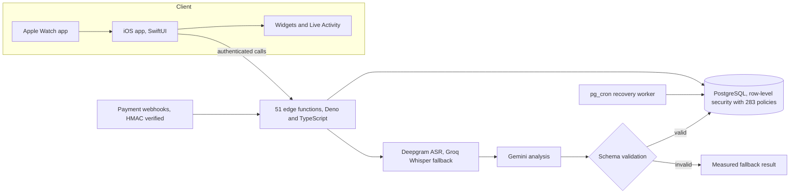

# Orately: AI Speech Coaching for iOS and Apple Watch

Orately records your speech and returns a structured coaching analysis with concrete suggestions and progress over time. It is a subscription iOS and watchOS app, **live on the App Store**, built end to end by one engineer.

**Status:** shipped. [Orately on the App Store](https://apps.apple.com/app/id6765478314)

> Source code is private. This repository is a README-only write-up of the architecture. Happy to walk through the code live: [adk08644@gmail.com](mailto:adk08644@gmail.com).

## Problem

Speech coaching needs fast, trustworthy feedback on a recording, but transcription plus LLM scoring is slow, can fail partway, and costs money on every attempt. The system has to never lose a recording, never score the same one twice, and never trust unvalidated model output.

## What it does

- Guided and free speaking practice with an AI analysis of each recording (clarity, pace, filler words, fluency)
- Live voice coaching sessions
- Apple Watch app for audio capture, plus widgets and a Live Activity during analysis
- Subscriptions with server-verified entitlements
- User data export and account deletion built in

## Architecture

## Key engineering decisions

**Crash-safe analysis jobs.** Each recording becomes a job row. Workers claim jobs atomically with `FOR UPDATE SKIP LOCKED`, so two workers never analyze the same recording and AI spend is not duplicated. A `pg_cron` recovery worker re-queues stalled analyses, and every attempt is recorded in a per-attempt history for monitoring and re-runs.

**Validated AI output with fallbacks.** The pipeline is Deepgram speech-to-text, then Gemini. Model output is parsed into schema-validated JSON before it reaches curated tables, so results can be inspected, replayed and recovered. If Gemini fails, the system returns a measured fallback; if the primary ASR fails, a Groq/Whisper ASR fallback takes over. Error alerts fire from the analysis function.

**Security and billing.** Row-level security isolates each user's data. Payment-provider webhooks are verified with HMAC signatures, and subscription entitlements are reconciled idempotently, so a replayed event cannot change state twice.

**Privacy.** Export and account deletion are server endpoints, not support requests.

**Safe schema evolution.** The schema is changed through 195 versioned migrations applied to live data.

## Verified figures

| Item | Value |
|---|---|
| Serverless edge functions | 51 |
| Row-level security policies | 283 |
| Versioned migrations | 195 |
| Declared test cases | about 590 (199 Swift, 393 Deno/TypeScript) |

## Tech stack

Swift, SwiftUI, watchOS, WidgetKit, TypeScript (Deno), PostgreSQL (Supabase), pg_cron, Deepgram, Gemini, fastlane, Xcode Cloud.
