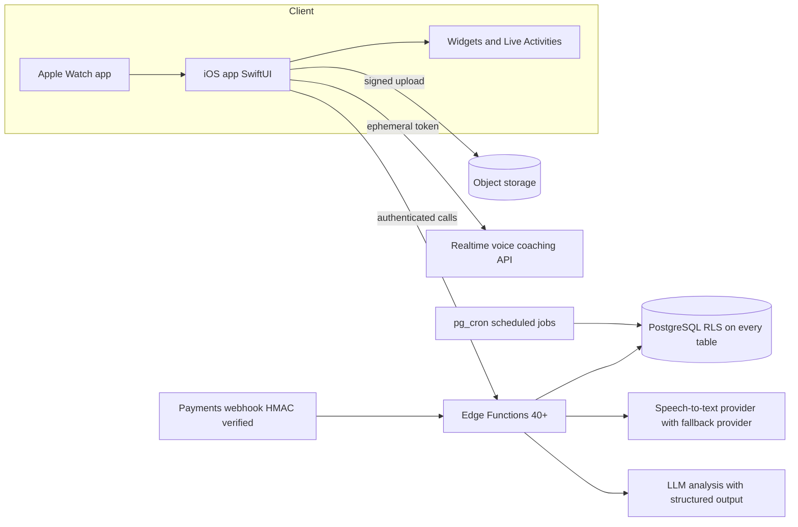

# Orately — Articulation Coach AI

**AI-powered speech coaching that sharpens your delivery, day by day.**

**[Download on the App Store →](https://apps.apple.com/in/app/articulation-coach-ai-orately/id6765478314)**

> Orately is a commercial product with live paid subscriptions. **The source code is private.**
> This repository documents the product and its architecture for engineers and recruiters.

---

## What it does

Orately records your speech — guided practice, free practice, or AI roleplay scenarios — and returns a structured coaching analysis: **clarity, pace, filler words, fluency, composure, and impact**, with concrete suggestions and progress tracking over time. It is built around a habit loop: daily missions, streaks, weekly leagues with tiered progression, vocabulary building, and long-term "transformation" milestones.

**Feature highlights**

- Guided speaking practice, diagnostics, and AI roleplay scenarios that evolve with your skill level
- **Real-time voice coaching** — a live conversational coach powered by a realtime LLM voice API
- **Apple Watch app** for on-wrist audio capture, synced to the phone
- Live Activities / Dynamic Island during recording, home-screen widgets for streaks
- Weekly leagues, badges, buddy matching, monthly challenges, and a year-in-review
- Privacy by design: recordings are used for analysis only and purged on a schedule; full data export and account deletion are built in

## Architecture

A native SwiftUI client (~240 Swift source files, plus Watch and Widget targets) backed by a serverless backend: **40+ edge functions** (Deno/TypeScript) over **PostgreSQL** — a schema of 25+ tables built up across **180+ versioned migrations**, with row-level security on every user-facing table.

### Design decisions worth reading

**Asynchronous, fault-tolerant analysis pipeline.** Speech analysis is slow (transcription + LLM scoring), so uploads never block the UI. Each recording becomes a job row in Postgres; a worker claims jobs via an **atomic claim** (a single `UPDATE … RETURNING` inside a security-definer function), which prevents two workers from analyzing the same recording — and therefore prevents duplicate AI spend. A **pg_cron recovery worker** sweeps every few minutes and re-drives jobs that stalled mid-flight, so a crashed function never strands a user's recording. Retryability is an explicit contract: every job records its attempt history and terminal state.

**Multi-provider AI with graceful degradation.** Transcription runs on a primary speech-to-text provider with automatic fallback to a second provider; LLM scoring validates the model's JSON against a schema and runs **schema-repair retries** when the output is malformed. The client never talks to AI providers directly — all keys live server-side, and the realtime voice coach uses short-lived **ephemeral tokens** minted per session.

**Security and privacy as schema, not policy.** Row-level security on every user table; payment webhooks verified with **HMAC** before any entitlement change; rate limits enforced **atomically in the database** rather than in application memory; an AI observability trail that **redacts PII** before logging; and scheduled jobs that purge expired audio. GDPR-style export and deletion are edge functions, not support tickets.

**Gamification server-side.** League standings, score percentiles, streak decay, and badge awards are computed by scheduled database jobs — the client renders state, it never computes rewards. That keeps the competitive layer consistent and cheat-resistant.

## Stack

| Layer | Technology |
|---|---|
| iOS / watchOS | Swift, SwiftUI, WidgetKit, Live Activities, AVFoundation |
| Backend | Supabase Edge Functions (Deno, TypeScript), PostgreSQL, pg_cron |
| AI | LLM analysis with structured outputs, realtime voice API, dual-provider speech-to-text |
| Payments | StoreKit 2 subscriptions, RevenueCat, HMAC-verified server webhooks |
| Release | fastlane, App Store Connect |

## Scale facts

- 40+ production edge functions
- 180+ versioned database migrations
- 25+ tables, RLS everywhere
- ~240 Swift source files across app, Watch, and widget targets
- Live on the App Store with paid subscriptions

---

*Want a walkthrough of any part of this system? I'm happy to go deep on the pipeline, the schema, or the client in an interview — [adk08644@gmail.com](mailto:adk08644@gmail.com).*
